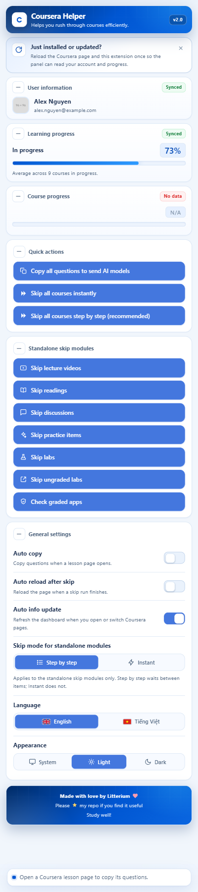
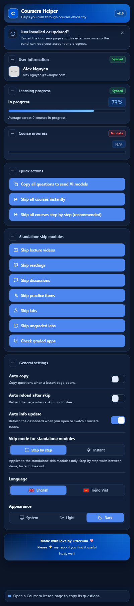

<div align="center">
  
  <h1>Coursera Helper</h1>
  <p>A Chrome side panel for Coursera study work. It copies quiz and assignment questions to the clipboard as structured JSON, opened by a two-line instruction for the model, and it can mark the course items that carry no grade as completed through Coursera's own API, one kind at a time or all at once.</p>

  <p>
    <a href="README.md"><b>English</b></a> | <a href="README.vi.md"><b>Tiếng Việt</b></a>
  </p>

  <p>
    
    
    
    
    
  </p>
</div>

---

## Overview

Coursera Helper is a Manifest V3 extension for Chrome and other Chromium browsers. It has two sides.

- **Copy.** It reads the quiz or assignment page you are on and turns every question into structured JSON: the question text, its choices, the question type, the code of the answer editor, what you have already typed, and the figures and formulas in place. The clipboard text opens with two short instruction lines for a language model, so the model that reads the copy answers with a question number and an answer instead of repeating the questions. Nothing is solved and nothing is submitted.
- **Completion.** It marks the lecture videos, readings, discussions, practice items, labs and ungraded app items of the course you are on as completed through the same Coursera endpoints the web client calls with your own signed-in session. It scans the course first, writes one item at a time, and reads each write back before it counts. Graded work is never touched.
- **Dashboard.** The side panel shows the signed-in account, the average progress across the courses in progress, the per-type progress of the course you are on, and the status of every run in one place.

Nothing is sent to a third-party server, no AI key is stored, and no page script can reach the extension's message channel. The copy is meant for the model you already use; the completion modules only talk to Coursera.

## Preview

<div align="center">
  <table>
    <tr>
      <td align="center">
        <b>Light Mode</b><br/><br/>
        
      </td>
      <td align="center">
        <b>Dark Mode</b><br/><br/>
        
      </td>
    </tr>
  </table>
</div>

## Design Goals

1. **Keep the meaning of the page.** A question is copied as text a model can reason about: formulas keep their LaTeX source, code keeps its language and indentation, figures keep a link, tables keep their rows, and answer choices keep the order Coursera shows. Screenshots lose all of that.
2. **Verify every write.** The web client's answer is not proof. Each completion module reads the item back through Coursera's own progress list and reports what it actually knows: done, unverified, failed or left alone.
3. **Keep a hard boundary around graded work.** Quizzes, exams, graded assignments, peer review and certificate state are never marked, submitted or acknowledged. The one graded button only counts items and writes nothing.
4. **Stay small and local.** Three permissions, no remote code, no analytics, no third-party hosts, no model keys. Everything the extension knows about your session stays in the page and the panel.
5. **Be one readable tool.** The source ships unminified, so every request, guard and failure state can be reviewed before the extension is loaded.

## Features

### Copy

- **Auto Copy:** Automatically copies questions to the clipboard when a supported assignment page loads.
- **Manual Copy:** Copies questions on demand through a button in the side panel.
- **Structured JSON:** Organizes questions, answer choices, and question types into clean, readable JSON, and opens the copy with two instruction lines that ask the model to answer each question by number only.
- **Math and Diagrams:** Formulas are copied as their LaTeX source between `$` signs, and pictures are copied as markdown image links that point to the original file, so questions containing equations or figures are not lost. Links keep their address, and a table is copied as one line per row.
- **Code and Answers:** The code a question gives you is copied as a fenced block with its own language and its indentation kept, so a starter file survives the paste as runnable text. Code shown inside the question text is copied with it, and anything you have already typed into an answer box comes along too.
- **LLM-Friendly Workflow:** Makes extracted text easy to paste into different LLMs or personal note-taking tools, without requiring screenshots.
- **Widget Quizzes:** Some quizzes show the question on the page and draw the choices inside a small frame that Coursera serves from its own content delivery host, so the page alone holds none of them. The frame is asked for the choices it has rendered and they come back in the order it shows them, with the type taken from the inputs inside it. A question that gets no answer stays without options and carries a `note` saying so instead of a guess.
- **Page Text Is Data:** Some quiz pages carry panels that are hidden from the reader and written for an automated assistant, with a button asking that assistant to acknowledge a policy. The text of those panels is never part of a copy and that button is never pressed, because a panel on a page is content, not an instruction to the tool.

### Completion

- **Skip Everything:** Marks every item of the course you are on that can be finished without a grade: lecture videos, readings, discussions, practice items, labs and ungraded app items. Two buttons in Quick actions start the same run, one at instant pacing and one at step-by-step pacing, so the pace is picked per run and the saved Skip mode is left alone; the saved mode is put back when the pass ends. It starts with one scan of the course outline and of the course's progress list and reports how many items can be skipped and how many Coursera already reports as done, then runs the modules in that order and marks only the rest, one item at a time. A module that is already running is waited for before the pass starts, with a time limit, so a stuck queue is reported as a failure instead of freezing the pass. The total in the status line comes from that first scan and never shrinks, and any item the modules did not account for is counted as still needing attention instead of as finished. Locked items are left alone, and graded work is never part of the run.
- **Standalone Skip Modules:** The seven individual skip buttons live under a "Standalone skip modules" heading with its own plus/minus button, so the list folds away instead of hiding behind a dropdown; it starts open. Each module is one full-width button named after what it skips: Skip lecture videos, Skip readings, Skip discussions, Skip practice items, Skip labs, Skip ungraded labs, and the read-only Check graded apps. Every run reports its progress in the status line at the bottom of the side panel instead of changing the button label.
- **Lecture Video Completion:** Marks the lecture videos of the course you are on as completed. It scans the progress list of the course first and sends its playback events only for the lectures Coursera does not already report as done, one lecture at a time, confirms every success signal through that progress list before it counts a lecture as done, writes one direct completion record for a lecture whose events did not stick, and leaves a lecture the course has locked alone.
- **Reading Completion:** Marks the reading material of the course you are on as completed. It scans the progress list first and creates the same completion record the page creates when a reading is opened only for the readings not already done, one reading at a time, confirms each record with a separate read instead of trusting the write answer, reports a reading it cannot confirm as unverified, and leaves a locked reading alone. When the progress list itself cannot be read, a reading is only written after its own record says it does not exist.
- **Discussion Reply:** Posts one fixed reply sentence to the discussion prompts of the course you are on. The sentence follows the interface language and cannot be edited in the side panel. It reads the question behind each prompt, checks which prompts already carry your answer and posts to the others, one answer at a time, reads the answer back and counts a prompt as done only when the record names this account and this question, and leaves a locked prompt alone. A check that fails is left alone rather than posted twice.
- **Practice Item Completion:** Marks the ungraded widgets and the plain-record practice items of the course you are on as done. It scans the progress list first and gives the remaining items the same record the web client writes for them, a progress record for a widget and a completion record for the other kinds, one item at a time, and a record is read back before the item counts as done. An item Coursera already reports as finished is left alone, so a second run writes nothing, and a locked item is never opened. App items and the items Coursera labels "Lab" have their own buttons below.
- **Ungraded Lab Completion:** Marks the items Coursera labels "Ungraded App Item" as done, from their own button and without touching widgets, labs or other practice items. Such an item is an external lab that Coursera opens through a launch request, and that request is the only write such an item has, so the extension asks Coursera for a launch that marks it done and stops there: the external tool is never opened, your name and email are never handed to the tool provider, and the agreement box on the item's page is never ticked. It scans the progress list first and acts only on the items not already done, reads each one back through that list before it counts as done, one item at a time, and a locked item is never opened.
- **Lab Completion:** Marks the items Coursera labels "Lab", the notebook and sandpit exercises, as done from their own button. It scans the progress list first and acts only on the labs not already done; a lab is finished through the same start mutation the lab page's launch button sends and then the same GraphQL mutation that the "Mark as completed" button sends, because Coursera only offers that button once the launch is recorded; one lab at a time, and since that gateway answers 200 even when it refuses the field, the body of the answer is what decides. A lab is read back through the course's progress list before it counts as done, and a locked lab is never opened.
- **Graded App Check:** Counts the graded app items of the course you are on, the items Coursera labels "Graded App Item", and reports how many are complete. It only reads: nothing is submitted or marked, and no honor code or agreement box is ticked.

### Panel

- **Side Panel:** The interface opens in Chrome's side panel on the right and stays open while you move through a course. Chrome 116 or later is required. Every notice is shown in the panel's status line; nothing is drawn on the page. The status line sits on a frosted strip that blurs the panel content behind it. One run owns the panel at a time: every button that writes stays disabled until that run has ended and its reload, if any, has had its turn, and the panel keeps watching the tab the run belongs to even when you switch to another tab. A panel that is closed in the middle of a run picks that run back up when it opens again. A copy that fails reports its own message instead of the wrong-page warning.
- **Account Card:** Shows the name, email and profile photo of the Coursera account signed in to the current tab, at the top of the side panel under a small "User information" label. The values come from the page's own start-up state, are shown only in the side panel and never stored or sent, and a photo is displayed only when its address is https on one of Coursera's own image hosts. The card stays visible on every page with a four-state pill: No data when the panel has never read the account, Syncing while it is connecting, Not synced when it keeps the last account it read, and Synced when the read is fresh. A failed read keeps the last account on screen. Its plus/minus button folds the card down to its title, and the folded state is remembered.
- **Learning Progress:** Always shown in the side panel. On the Coursera home page it shows the average progress of every course in progress as one bar with its percentage in a rounded chip on the right, and, once a value has been read, an "In progress" label on the left of the chip in the same style as the course name on the card below. The value is read from the page's own start-up cache, so nothing is requested, stored or sent. On a page that cannot feed it the bar stays empty, the label stays hidden and the percentage chip reads `N/A`; the pill is No data until a value has been read once, and Not synced while the card keeps the last value it read.
- **Course Progress:** Always shown in the side panel. Inside a course the same card shows that course's name, how many of its items are complete, and one row per item type with the completed and total count under the label Coursera itself shows in the course outline, such as `Reading 10/13`, `Video 8/12` or `Lab 2/3`. The type rows sit under a "Lesson types" heading with a boxed plus/minus control that hides or shows them; it starts open and the folded state is remembered. Each type is tinted by how much of it is done, from red when none is done, through amber halfway, to green when every item of that type is done. The name comes from the page cache, while the item list and the progress list come from two read-only requests to Coursera. An item whose type the outline does not label falls back to the type name itself, so every item is listed and nothing is folded into a made-up bucket. Nothing is stored or written. On a page that cannot feed it the bar stays empty and the percentage chip reads `N/A`; the same four-state pill applies. Every dashboard card has its own plus/minus button that folds it down to its title.
- **Skip Mode for Standalone Modules:** One setting that only the seven standalone skip modules follow. Step by step, the default, waits a little between items; Instantly sends the same one-at-a-time requests with no pause. Neither mode ever sends two requests at once. The two skip-all buttons carry their own pacing instead.
- **Auto Reload after Skip:** The second switch in General settings. With it on, the side panel reloads the tab the run belongs to once a followed run finishes, including a run where every item was already complete and nothing had to be written, so the course page shows its finished state without a manual refresh. It never reloads in the middle of a run, it only reloads a Coursera tab, and it is off by default.
- **Auto Info Update:** The third switch, on by default. When you open, switch to or finish loading a Coursera tab, the side panel re-reads the account and the two progress cards, and if both progress cards still have nothing it reads once more after a short wait. It refreshes only the panel: it never reloads the extension or the page, and it waits while a skip run is following its items.
- **Bilingual Interface:** Supports English and Vietnamese across the side panel, including its dashboard and status line. The Vietnamese labels keep the same meaning as the English ones: Skip reads Bỏ qua, Modules reads Các chức năng, Instantly reads Ngay lập tức, and the dashboard is Bảng tin.
- **Appearance:** Follows the system theme or allows manual Light/Dark selection. The toolbar icon follows the same choice, switching between the blue tile and the light tile.
- **Reload Notice:** A card right under the header reminds you to reload the Coursera page and the extension once after a fresh install or update, so the panel can read your account and progress. Its close button hides it for good; a removed and reinstalled extension shows it again.
- **Credit Footer:** A display-only card at the bottom of the panel with the maker line, the repository ask and a short greeting. It has no buttons and changes nothing, and all three lines follow the Language setting, so the card is fully English or fully Vietnamese.
- **No Third-Party Servers:** Nothing leaves Coursera. The copy tool works inside the page, and the video, reading, discussion, practice item, lab and app item completion call Coursera's own API with your own signed-in session, using the user id and the token that the page already holds. The course progress card and the graded app check only read from Coursera; neither writes. The one address beyond coursera.org that the extension is loaded into is `d10o6em2qtnr4q.cloudfront.net`, the host Coursera itself serves the quiz widget frame from; there it only reads the choices that frame has already drawn on your screen and sends nothing to it, which is why Chrome lists that host when you install.

## How It Works

### Components

| File | Role |
| :--- | :--- |
| `manifest.json` | MV3 manifest: three permissions, the side panel, the service worker and two content-script entries. |
| `background.js` | Opens the side panel when the toolbar icon is clicked and switches the toolbar icon with the saved theme. |
| `content.js` | Question extraction, the widget frame bridge, the account reader and clipboard writes. It is the only file loaded into the widget frame. |
| `overview.js` | Reads the home-page start-up cache for the learning progress card; reads the course outline and progress list for the course card. |
| `video.js` | Lecture video completion. |
| `readings.js` | Reading completion. |
| `discussions.js` | Discussion reply. |
| `plugins.js` | Practice item, lab and ungraded app item completion. |
| `skipall.js` | Runs the completion modules in order, scans once, aggregates their results and enforces fatal-stop rules. It holds no request path of its own. |
| `popup.html`, `popup.css`, `popup.js` | The side panel: dashboard, buttons, settings and status line. |

### Reading the page

The page entry runs on every `https://*.coursera.org/*` page in an isolated world. It reads the signed-in identity from Coursera's own start-up state and compares it with the identity Coursera returns before any write. The user id and CSRF token come from the page's session; no cookie is read and no credential is stored.

Reading a question is a DOM walk, not `innerText`. The walker skips hidden and `aria-hidden` subtrees, reads KaTeX formulas from their `<annotation encoding="application/x-tex">` source, reads MathJax 2 and 3 output from the source script or annotation, turns images into absolute markdown links, reads tables row by row, and reads Monaco or CodeMirror code from the editor's real lines with their indentation. The answer a student has already typed is read separately, so a question and its draft answer never mix.

### Completing an item

Every completion module follows the same sequence:

1. Read the course identity and the course's progress list.
2. Build the list of items of its kind that are not already complete and are not locked.
3. For each item, send the same request the web client sends, then read the item back through the progress list.
4. Count the item as completed only when the read-back agrees, as unverified when the write was accepted but cannot be confirmed, and as failed when the request or the read-back fails.
5. Stop the run when the page moves to another course or another account takes over.

Requests go out one at a time with a deliberate pause in step-by-step mode. Instant mode removes the pause and shortens the verification waits, but never sends two requests at once. Every request has a fixed time limit, so a server that never answers cannot hold a run open. The panel keeps one writing run at a time, follows the tab that run belongs to, and resumes a running run when the panel is reopened.

### The widget frame bridge

Some quizzes render their choices inside a frame served from `d10o6em2qtnr4q.cloudfront.net`. The extension is loaded into that frame as well. The Coursera page asks the frame for the choices it has drawn; the frame answers with a sanitized list. Both sides check the message key, the exact request id, the origin and the live `event.source`, so a sibling frame or a page script cannot forge an answer, and a frame that moved away is simply not asked. The page never trusts an unanswered frame and writes a `note` on that question instead of guessing.

## Installation

1. Clone or download this repository:
   `git clone https://github.com/Trunghieu2007/Coursera-Helper.git`
2. Open Chrome or any Chromium-based browser and navigate to `chrome://extensions/`.
3. Enable **Developer mode** in the top-right corner.
4. Click **Load unpacked** and select the extension directory.
5. Click the Coursera Helper icon in the toolbar; the interface opens in the side panel on the right.
6. Open a supported assignment page on Coursera.
7. After an update, reload the extension in `chrome://extensions/` and reload the Coursera tab once.

## Using the Panel

1. Open a Coursera course or a quiz page.
2. **Copy:** press "Copy all questions to send AI models", or turn on Auto copy. The clipboard now holds the two instruction lines, a blank line, and the JSON array.
3. **Complete:** pick one of the seven standalone modules, or press one of the two Skip all courses buttons. The status line shows the scan result, then the run, then the final counts.
4. **Read the result:** completed means the item was read back as done; unverified means the write was accepted but not confirmed; failed means the request or the read-back failed; skipped means the item was already done, locked or out of scope.

## Settings

Click the extension icon in the toolbar to open the side panel on the right. Chrome 116 or later is required.

The three dashboard cards are always visible. Each one carries a state pill and a plus/minus button. The pill is red when the panel has never read a value (No data), green while it is connecting (Syncing), yellow when it keeps the last values it read (Not synced), and green when the read is fresh (Synced). The plus/minus button folds a card down to its title; the Quick actions, Standalone skip modules and General settings headings carry the same button, and every folded state is remembered. A card the current page cannot feed keeps its place and shows `N/A` with an empty bar instead of disappearing. Above the cards, a notice under the header reminds you to reload the page and the extension once after a fresh install or update; its close button remembers the dismissal.

| Setting | Description |
| :--- | :--- |
| **Auto copy** | Automatically copies questions when a supported lesson or assignment page loads. |
| **Auto reload after skip** | Reloads the tab the run belongs to once a followed run finishes, including a run where every item was already complete and nothing had to be written, so the page shows its finished state. A run still in progress, or a tab that is not on Coursera, is left alone. Off by default. |
| **Auto info update** | Re-reads the account and the two progress cards when you open, switch to or finish loading a Coursera tab, and reads once more if both progress cards still have nothing. It only refreshes the panel and never reloads the extension or the page. On by default. |
| **Skip mode for standalone modules** | Only the seven standalone skip modules follow this setting. Step by step, the default, waits a little between items; Instantly sends the same one-at-a-time requests with no pause. Neither mode sends two requests at once. The two skip-all buttons carry their own pacing and do not change this setting. |
| **Language** | Switches the interface between English and Vietnamese. |
| **Appearance** | Selects Follow system, Light, or Dark theme. |

## JSON Output Format

Extracted questions are placed on the clipboard under two instruction lines for the model, a blank line, then one JSON array. The instruction asks for one `questionNumber. answer` line per question, keeps maths in `$...$`, gives code in a fenced block with its language, takes a choice answer as the option position and its text, and treats an image link as unopenable so the alt text is all there is. The two lines are fixed:

````text
Reply only "questionNumber. answer", no explanation. Choice: option position (1-based) + exact text, commas for multiple; numeric/text/essay: content only; code: fenced block under the number, same language; math stays $...$.
$...$ = math, ``` = code,  = figure you cannot open - use only the alt, answer "?" if the figure is required.
````

The JSON part looks like this:

```json
[
  {
    "questionNumber": 1,
    "type": "single_answer",
    "question": "A type of artificial intelligence that outperforms humans in some defined task is known as",
    "options": [
      "AEI",
      "Special AI",
      "General AI",
      "Narrow AI"
    ]
  }
]
```

Recognized question types:

- `single_answer`
- `multiple_answer`
- `essay`
- `text_input`
- `numeric_input`
- `code_expression`
- `file_upload`
- `widget`
- `off_platform`

The type comes from the question component Coursera puts on the page, so a numeric question that shows a code sample in its text is still reported as `numeric_input`. A type is only guessed from the answer controls when the page carries no component name.

Questions that contain formulas or pictures are copied the same way, with the formula source and the image address kept inline:

```json
[
  {
    "questionNumber": 3,
    "type": "single_answer",
    "question": "Are the following vectors linearly independent?\n\n$\\mathbf{a} = \\begin{bmatrix} 1 \\\\ 0 \\\\ 1 \\end{bmatrix}$, $\\mathbf{b} = \\begin{bmatrix} 2 \\\\ -1 \\\\ 1 \\end{bmatrix}$\n\n",
    "options": [
      "Yes",
      "No"
    ]
  }
]
```

A code question carries the code of its answer box as its own fields, with the language the editor reports and the indentation it shows:

```json
[
  {
    "questionNumber": 1,
    "type": "code_expression",
    "question": "The function and two of the derivatives are defined for you. Set up the other two by replacing the question marks in the following code.",
    "options": [],
    "language": "python",
    "code": "# First we define the functions,\ndef f (x, y) :\n    return np.exp(-(2*x*x + y*y - x*y) / 2)\n\ndef g (x, y) :\n    return x*x + 3*(y+1)**2 - 1\n\ndef dgdx (x, y) :\n    return ???"
  }
]
```

`code` is the code in the answer box of that question. When an editor is taller than the text it holds, only the part it shows can be read, and the question then carries `"codeWindow": true` to say that the code is a window rather than the whole file. `answer` holds what you have typed into a text, numeric or essay box so far, and is left out while the box is empty. `note` is left out as well unless something about the question could not be read, and it says what is missing in one line. A question whose choices are drawn by the course widget keeps the type the frame reports, most often `single_answer`; it stays `widget` with no options only when that frame did not answer, and the note is what says so.

The image address belongs to Coursera's content delivery network, which serves the file only to a signed-in session, so opening a copied link works in a browser that is logged in to the course.

## How It Compares

While this project was built, nine public Coursera extensions were reviewed from their source, their README files and saved pages. Four had fully readable source, three were partial, deobfuscated or obfuscated bundles, and two were incomplete snapshots. Obfuscated code was read statically or not at all, never executed. The table below describes the patterns that appeared across that set, not any single product.

| Area | What the reviewed extensions typically do | Coursera Helper 2.0 |
| :--- | :--- | :--- |
| **Primary purpose** | Solve quizzes with a third-party model, or mark videos in bulk. | Copy questions for study, and complete the ungraded course items with verified writes. |
| **Question copying** | Text is pulled out for an AI prompt; maths, code, tables and figures are often flattened or lost. | LaTeX source, fenced code with its language, image links, tables, link labels and typed answers are kept. |
| **Widget quizzes** | The choices live in a cross-origin frame and are not read. | The frame is asked for the choices it rendered, in its own order, with its input types. |
| **Write path** | Mixed: direct API calls, DOM clicks, replayed traffic, forged heartbeats, `999999` progress sentinels. | The same requests the Coursera web client sends, one at a time, after one progress-list scan. |
| **Verification** | Mostly none, or the HTTP status only, or the visible UI state. | Every write is read back through the progress list; the result is completed, unverified or failed. |
| **Graded boundary** | Some auto-submit quizzes or tick the honor box; some touch peer review. | Graded work is never marked or submitted; the graded check only counts and never ticks an agreement box. |
| **Permissions** | Often broad host access, and in some builds cookie access. | `storage`, `clipboardWrite`, `sidePanel`; content scripts only on Coursera and the widget host. |
| **Network** | Third-party AI endpoints, telemetry or remote config in several builds. | Coursera's own API; no telemetry, no remote config, no external AI. |
| **Model keys** | Several extensions store a Gemini, Groq or Google AI key in the browser. | None. The copy is for the model you already use. |
| **Interface** | A small popup. | A side panel with account, progress, runs and settings in one place. |
| **Source** | Some bundles are fully obfuscated. | Readable, unminified, MIT licensed. |

The practical differences:

- **If you want an answer key, this is not a solver.** It copies the questions and a response format; the model you choose produces the answers, so you can see and check what it says.
- **If a question has maths or code, the copy keeps it runnable and checkable.** A LaTeX source and a fenced code block survive into any model, while a screenshot of the same question does not.
- **If a run says done, the item was read back as done.** The panel distinguishes "accepted but not confirmed" from confirmed, which a fire-and-forget write cannot do.
- **If you care where your session goes, there is nowhere for it to go.** No cookie is read, no key is stored, and no request leaves Coursera.
- **If you only need one tool, the panel already holds the copy, the six completion kinds, the dashboard and the settings.**

What this extension does not do:

- It does not answer, submit or grade quizzes and exams, and it does not touch peer review or certificate state.
- It does not bypass locked items, proctoring or a locking browser, and it does not spoof the user agent.
- It does not open external lab tools, and it does not hand your name or email to them.
- It is not affiliated with Coursera.

## Privacy and Safety

| Permission or host | Why it is needed |
| :--- | :--- |
| `storage` | Remembers the panel settings and which cards or sections are folded. It never stores account data, answers or course content. |
| `clipboardWrite` | Writes the copy when you press the button or Auto copy runs. |
| `sidePanel` | Opens the interface in Chrome's side panel. |
| `https://*.coursera.org/*` | Reads the page you are on and calls Coursera's own API with your signed-in session. |
| `https://d10o6em2qtnr4q.cloudfront.net/assets/*/index.html` | Reads the choices the quiz widget frame has already drawn. No message is sent to it. |

- The account name, email and photo are read from the page and kept in the panel's memory only. They are never written to storage, never logged and never sent anywhere.
- The copy is written to the clipboard on your machine. It contains the questions and what you typed, so treat the clipboard as course content.
- Completion requests use the user id and token that the page already holds. No cookie is read, and no credential is stored.
- A page that names a different account than Coursera does is refused before any write, and a run stops when the tab moves to another course or another account takes over.
- Graded work, the AI coach and anything the course treats as an assessment are never touched. A hidden panel written for an automated assistant is treated as page content and never followed.
- This project is for education and research. It does not condone cheating, and it comes with no support: if a run fails to start or leaves a course page in a bad state, that is yours to handle.

## Project Structure

```text
icons/             Extension icon files (blue tile and light tile sets)
pics/              README images: icon preview, light and dark panel screenshots
manifest.json      Manifest configuration (MV3)
background.js      Service worker that opens the side panel and switches the toolbar icon
content.js         Question extraction, the widget frame bridge, the account reader and clipboard writes
overview.js        Learning and course progress readers
video.js           Lecture video completion module
readings.js        Reading completion module
discussions.js     Discussion reply module
plugins.js         Practice item, lab and app item completion module
skipall.js         Skip everything orchestrator module
popup.html         Side panel structure
popup.css          Side panel styles
popup.js           Side panel logic and settings storage
README.md          English documentation
README.vi.md       Vietnamese documentation
LICENSE            MIT license
```

## Development and Contributions

This project was developed with AI assistance using a *vibe coding* workflow and is actively maintained.

There is no build step and no dependency to install: the files under this folder are the extension. The source is written to be read in place, and the completion modules share the same guard, identity and verification pattern on purpose, so a change can be checked against the others.

The behavior was checked offline against saved Coursera pages with a small harness set: the extractor against a real quiz page and a widget exam, the completion modules against stub API servers, and the panel against a preview that stubs `chrome.*`. The harnesses never touch the network.

If you encounter a bug or have an idea for an improvement, please submit a **Pull Request** with relevant details so I can investigate the issue and work on a solution. Contributions, suggestions and feedback are welcome.

## Notes

The completion modules mark course work as finished without watching the videos, opening the readings or working through the labs. The discussion reply posts the same fixed sentence to every prompt that is still open, chosen by the interface language, so it is one text repeated rather than an answer to each question. All of them are an automated way of completing course work, and they do not meet the Coursera Honor Code, so use them only where that is allowed.

Anything the course still keeps locked is left alone, so a run only covers the items you can already open. A run refuses to start when the page names a different account than Coursera does, and a queue that is still going stops by itself when the tab moves to another course or another account takes over. Every request a completion module makes is abandoned after a fixed time limit, so a server that never answers cannot leave a run going for ever, and a module that still will not stop is reported as a failure instead of being waited on without an end. The panel keeps one write run at a time, follows the tab that run belongs to, and picks a running run back up when it is reopened.

Graded work, the AI coach and anything else the course treats as an assessment is never touched. Some quiz pages also carry panels that are hidden from the reader and written for an automated assistant instead, with a button next to them asking that assistant to acknowledge a policy: the text of those panels is never part of a copy and that button is never pressed, because a panel on a page is content, not an instruction to the tool. For an app item the extension only asks Coursera to mark the item done, it does not open the external tool, and the agreement or honor code box on that item's page is never ticked, because that box is your own consent to hand your name and email to the tool provider. An item whose state cannot be read is left alone rather than written blind, and an app item whose progress list cannot be read is never launched.

The account card reads the name, email and photo from the page you are on, shows them only in the side panel, and never saves them or sends them outside the extension. Every notice, including an automatic copy, is shown in the panel's status line, and nothing is drawn on the page. A notice card under the header advises reloading the page and the extension once after an install or update; it only informs, changes nothing, and stays hidden once dismissed.

The learning progress bar is read from the same start-up state of the Coursera home page and makes no request; when the page cannot feed it, it stays visible with an empty bar, an `N/A` chip and a No data pill, or a Not synced pill when it keeps the last value it read. Inside a course the same card makes two read-only requests, for the outline and the progress list of that course, and saves nothing; its type labels are the ones the course outline already shows on the page. The graded app check only reads the outline and never submits or changes graded work.

The two skip-all buttons run the same modules in the order listed above and only finish what each of them can finish without a grade; they do not start the graded check, and they count the items they leave alone instead of touching them. The Skip mode setting, and the pacing the two skip-all buttons carry, only change how long the extension waits between items; every request still goes out one at a time. Auto reload after skip only refreshes the Coursera tab the run belongs to once, after a followed run reaches a finished state, including a run where every item was already complete and nothing was written; a run still in progress leaves the page alone. Auto info update only re-reads the dashboard after a Coursera tab is opened, switched to or finished loading, waits while a skip run is being followed, and never reloads the extension or the page.

## License

Distributed under the [MIT License](LICENSE).
