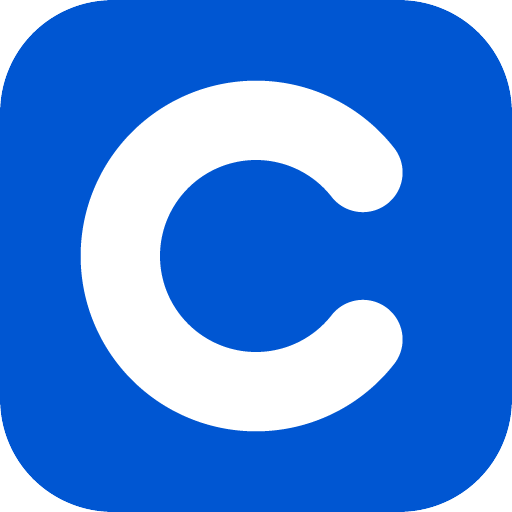
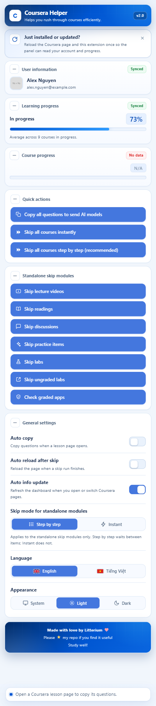
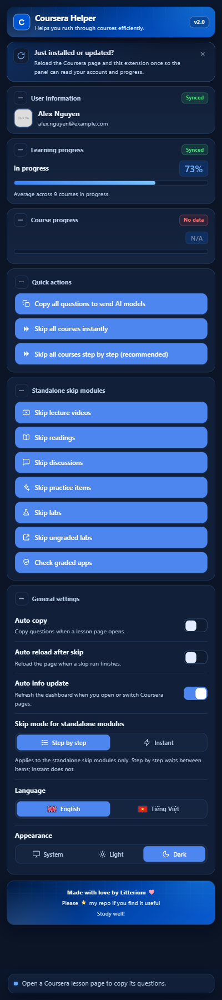

<div align="center">
  
  <h1>Coursera Helper</h1>
  <p>Một side panel của Chrome dành cho việc học trên Coursera. Tiện ích sao chép câu hỏi bài kiểm tra và bài tập vào bảng nhớ tạm dưới dạng JSON có cấu trúc, mở đầu bằng hai dòng hướng dẫn cho mô hình, và có thể đánh dấu các mục không mang điểm của khoá học là đã hoàn thành qua API của chính Coursera, theo từng loại hoặc tất cả cùng lúc.</p>

  <p>
    <a href="README.md"><b>English</b></a> | <a href="README.vi.md"><b>Tiếng Việt</b></a>
  </p>

  <p>
    
    
    
    
    
  </p>
</div>

---

## Tổng quan

Coursera Helper là một tiện ích Manifest V3 cho Chrome và các trình duyệt nhân Chromium. Tiện ích có hai phần chính.

- **Sao chép.** Nó đọc trang bài kiểm tra hoặc bài tập bạn đang mở và chuyển từng câu hỏi thành JSON có cấu trúc: nội dung câu hỏi, các phương án, loại câu hỏi, code trong khung trả lời, những gì bạn đã gõ, cùng hình ảnh và công thức giữ nguyên tại chỗ. Văn bản trên clipboard mở đầu bằng hai dòng hướng dẫn ngắn cho mô hình ngôn ngữ, nên mô hình đọc bản sao trả lời bằng số thứ tự câu và đáp án thay vì lặp lại câu hỏi. Không có gì được giải và không có gì được nộp.
- **Hoàn thành.** Nó đánh dấu các video bài giảng, bài đọc, thảo luận, bài thực hành, lab và mục ứng dụng chưa cho điểm của khoá học bạn đang mở là đã hoàn thành qua đúng các endpoint Coursera mà web client gọi bằng chính phiên đăng nhập của bạn. Nó quét khoá học trước, ghi từng mục một, và đọc lại từng lần ghi trước khi tính. Bài chấm điểm không bao giờ bị chạm tới.
- **Bảng tin.** Side panel hiện tài khoản đang đăng nhập, tiến độ trung bình của các khoá đang học, tiến độ từng loại mục của khoá đang mở, và trạng thái của mọi lần chạy ở cùng một chỗ.

Không có gì được gửi tới máy chủ bên thứ ba, không có khoá AI nào được lưu, và không script nào trên trang với tới được kênh message của tiện ích. Bản sao dành cho mô hình bạn vốn đã dùng; các module hoàn thành chỉ nói chuyện với Coursera.

## Giao diện

<div align="center">
  <table>
    <tr>
      <td align="center">
        <b>Chế độ Sáng</b><br/><br/>
        
      </td>
      <td align="center">
        <b>Chế độ Tối</b><br/><br/>
        
      </td>
    </tr>
  </table>
</div>

## Mục tiêu thiết kế

1. **Giữ ý nghĩa của trang.** Câu hỏi được sao chép thành văn bản mà mô hình có thể suy luận: công thức giữ mã LaTeX, code giữ ngôn ngữ và thụt lề, hình ảnh giữ một liên kết, bảng giữ từng hàng, và phương án trả lời giữ đúng thứ tự Coursera hiển thị. Ảnh chụp màn hình làm mất tất cả những thứ đó.
2. **Xác minh mọi lần ghi.** Câu trả lời của web client không phải bằng chứng. Mỗi module hoàn thành đọc lại mục qua danh sách tiến độ của chính Coursera và báo đúng những gì nó biết: đã xong, chưa xác minh, thất bại hoặc được bỏ qua.
3. **Giữ ranh giới cứng quanh bài chấm điểm.** Bài kiểm tra, bài thi, bài tập chấm điểm, peer review và trạng thái chứng chỉ không bao giờ bị đánh dấu, nộp hay xác nhận. Nút chấm điểm duy nhất chỉ đếm mục và không ghi gì.
4. **Nhỏ và cục bộ.** Ba quyền, không code từ xa, không analytics, không máy chủ bên thứ ba, không khoá mô hình. Mọi thứ tiện ích biết về phiên của bạn đều ở lại trong trang và trong panel.
5. **Là một công cụ đọc được.** Mã nguồn phát hành không rút gọn, nên từng yêu cầu, guard và trạng thái lỗi có thể được xem lại trước khi nạp tiện ích.

## Tính năng

### Sao chép

- **Tự động sao chép:** Tự động sao chép câu hỏi vào bảng nhớ tạm khi một trang bài tập được hỗ trợ tải xong.
- **Sao chép thủ công:** Sao chép câu hỏi theo yêu cầu qua một nút trong side panel.
- **JSON có cấu trúc:** Sắp xếp câu hỏi, phương án trả lời và loại câu hỏi thành JSON sạch, dễ đọc, và mở đầu bản sao bằng hai dòng hướng dẫn yêu cầu mô hình chỉ trả lời từng câu theo số thứ tự.
- **Công thức và hình ảnh:** Công thức được sao chép dưới dạng mã LaTeX giữa hai dấu `$`, hình ảnh được sao chép dưới dạng liên kết markdown trỏ tới tệp gốc, nên câu hỏi chứa phương trình hay hình minh hoạ không bị mất nội dung. Liên kết giữ nguyên địa chỉ, và bảng được sao chép thành một dòng cho mỗi hàng.
- **Code và câu trả lời:** Code mà câu hỏi đưa sẵn được sao chép thành một khối fenced kèm ngôn ngữ riêng và giữ nguyên thụt lề, nên một tệp khởi đầu vẫn là văn bản chạy được sau khi dán. Code hiển thị bên trong đề được chép cùng đề, và những gì bạn đã gõ vào ô trả lời cũng đi theo.
- **Quy trình thân thiện với LLM:** Giúp văn bản đã trích xuất dễ dán vào các mô hình ngôn ngữ lớn hoặc công cụ ghi chú cá nhân, không cần ảnh chụp màn hình.
- **Bài kiểm tra dạng widget:** Một số bài kiểm tra hiện câu hỏi trên trang và vẽ các phương án trong một khung nhỏ mà Coursera phục vụ từ máy chủ nội dung riêng, nên chỉ trang thì không chứa phương án nào. Khung được hỏi lấy các phương án nó đã vẽ, và chúng quay về đúng thứ tự khung hiển thị, với kiểu lấy từ các ô nhập bên trong. Câu hỏi không nhận được trả lời sẽ ở lại không có phương án và mang một `note` nói rõ điều đó thay vì một phỏng đoán.
- **Chữ trên trang là dữ liệu:** Một số trang bài kiểm tra mang những khung bị ẩn với người đọc và viết cho một trợ lý tự động, kèm một nút yêu cầu trợ lý đó xác nhận một quy định. Chữ trong các khung ấy không bao giờ nằm trong bản sao và nút đó không bao giờ được bấm, vì một khung trên trang là nội dung chứ không phải lệnh dành cho công cụ.

### Hoàn thành

- **Bỏ qua mọi bài có thể:** Đánh dấu mọi bài của khoá đang mở có thể hoàn thành mà không cần điểm: video bài giảng, bài đọc, thảo luận, bài thực hành, lab và mục ứng dụng chưa cho điểm. Hai nút trong Tác vụ nhanh chạy cùng một quy trình, một nút ở nhịp ngay lập tức và một nút ở nhịp từng bước, nên nhịp được chọn theo từng lần chạy và thiết lập Chế độ bỏ qua đã lưu không bị đổi; chế độ đã lưu được trả lại khi lần chạy kết thúc. Tiện ích bắt đầu bằng một lần quét mục lục khoá học và danh sách tiến độ của khoá, báo có bao nhiêu bài có thể bỏ qua và bao nhiêu bài Coursera đã báo xong, rồi chạy các module theo đúng thứ tự đó và chỉ đánh dấu phần còn lại, từng bài một. Module đang chạy được chờ trước khi lần chạy bắt đầu, có giới hạn thời gian, nên một hàng đợi kẹt được báo là lỗi thay vì làm lần chạy đứng mãi. Tổng số trên dòng trạng thái lấy từ lần quét đầu đó và không bị co lại, còn bài nào mà các module không tính tới được ghi là còn cần xử lý thay vì tính là đã xong. Bài bị khoá được bỏ qua, và bài chấm điểm không bao giờ nằm trong lần chạy.
- **Các chức năng bỏ qua độc lập:** Bảy nút bỏ qua riêng nằm dưới nhãn "Các chức năng bỏ qua độc lập" có nút +/− riêng, nên danh sách được thu lại thay vì ẩn trong dropdown; mặc định mở. Mỗi chức năng là một nút rộng hết hàng, tên theo đúng việc nó làm: Bỏ qua video bài giảng, Bỏ qua bài đọc, Bỏ qua thảo luận, Bỏ qua bài thực hành, Bỏ qua lab, Bỏ qua lab chưa cho điểm và nút chỉ đọc Bỏ qua bài chấm điểm. Mọi lần chạy báo tiến độ ở dòng trạng thái cuối side panel thay vì đổi nhãn nút.
- **Hoàn thành video bài giảng:** Đánh dấu các video bài giảng của khoá học đang mở là đã hoàn thành. Tiện ích quét danh sách tiến độ của khoá trước và chỉ gửi các sự kiện phát video mà trình phát của trang tự gửi cho những video Coursera chưa báo xong, từng video một, xác nhận mọi tín hiệu thành công qua chính danh sách tiến độ đó trước khi tính là hoàn thành, ghi thêm một bản hoàn thành trực tiếp cho video chưa bám, và bỏ qua video mà khoá học đang khoá.
- **Hoàn thành bài đọc:** Đánh dấu các bài đọc của khoá học đang mở là đã hoàn thành. Tiện ích quét danh sách tiến độ trước và chỉ tạo bản ghi hoàn thành giống bản ghi trang tạo khi mở một bài đọc cho những bài chưa xong, từng bài một, xác nhận từng bản ghi bằng một lần đọc riêng thay vì tin câu trả lời của lần ghi, báo bài không xác nhận được là chưa xác minh, và bỏ qua bài đọc đang bị khoá. Khi chính danh sách tiến độ không đọc được, bài đọc chỉ được ghi sau khi bản ghi của nó nói rằng nó chưa tồn tại.
- **Trả lời thảo luận:** Đăng một câu trả lời cố định vào các thảo luận của khoá học đang mở. Câu này đổi theo ngôn ngữ giao diện và không thể sửa trong side panel. Tiện ích lấy câu hỏi đứng sau từng thảo luận, kiểm tra thảo luận nào đã có câu trả lời của bạn và chỉ đăng vào các thảo luận còn lại, từng câu một, đọc lại câu trả lời và chỉ tính là hoàn thành khi bản ghi ghi đúng tài khoản này và đúng câu hỏi này, và bỏ qua thảo luận đang bị khoá. Lần kiểm tra lỗi thì để yên thay vì đăng lặp lần hai.
- **Hoàn thành bài thực hành:** Đánh dấu các widget chưa cho điểm và các bài thực hành chỉ có bản ghi của khoá học đang mở là đã xong. Tiện ích quét danh sách tiến độ trước và ghi cho các bài còn lại đúng bản ghi mà trang web ghi cho chúng, bản ghi tiến độ cho widget và bản ghi hoàn thành cho các loại khác, từng bài một, và bản ghi được đọc lại trước khi bài được tính là hoàn thành. Bài mà Coursera đã báo là xong sẽ được giữ nguyên, nên một lần chạy sau không ghi gì thêm, còn bài đang bị khoá thì không bị mở ra. Mục ứng dụng và các bài Coursera gọi là "Lab" có nút riêng bên dưới.
- **Hoàn thành lab chưa cho điểm:** Đánh dấu các mục mà Coursera gọi là "Ungraded App Item" là đã xong, bằng nút riêng và không chạm tới widget, lab hay bài thực hành khác. Mục ứng dụng là một lab bên ngoài mà Coursera mở bằng một yêu cầu khởi động, và yêu cầu đó là thao tác ghi duy nhất của loại bài này, nên tiện ích chỉ hỏi Coursera một lần khởi động có đánh dấu hoàn thành rồi dừng lại: công cụ bên ngoài không được mở, tên và email của bạn không được gửi cho nhà cung cấp công cụ, và ô đồng ý trên trang của bài không bao giờ được tick. Tiện ích quét danh sách tiến độ trước và chỉ xử lý các mục chưa xong, đọc lại từng mục qua danh sách đó trước khi tính là hoàn thành, từng mục một, và không bao giờ mở mục đang bị khoá.
- **Hoàn thành lab:** Đánh dấu các bài mà Coursera gọi là "Lab", tức các bài notebook và sandpit, là đã xong bằng nút riêng. Tiện ích quét danh sách tiến độ trước và chỉ xử lý các lab chưa xong; lab được đánh dấu xong bằng đúng mutation khởi động mà nút Launch lab của trang gửi trước, rồi tới đúng mutation GraphQL mà nút "Mark as completed" gửi sau, vì Coursera chỉ hiện nút đó khi lần khởi động đã được ghi nhận; từng lab một, và vì gateway đó trả về 200 ngay cả khi từ chối, phần thân của câu trả lời mới là thứ quyết định. Lab được đọc lại qua danh sách tiến độ của khoá trước khi được tính là hoàn thành, và lab đang bị khoá thì không bị mở ra.
- **Kiểm tra bài chấm điểm:** Đếm các mục app chấm điểm của khoá đang mở, tức các mục Coursera gọi là "Graded App Item", và báo có bao nhiêu mục đã xong. Tính năng chỉ đọc: không nộp, không đánh dấu, và không tick ô quy tắc danh dự hay ô đồng ý nào.

### Side panel

- **Side panel:** Giao diện mở trong side panel bên phải của Chrome và giữ nguyên khi bạn chuyển qua lại trong khoá học. Cần Chrome 116 trở lên. Mọi thông báo đều hiện ở dòng trạng thái trong panel; không có gì được vẽ lên trang. Dòng trạng thái nằm trên một dải kính mờ làm nhoè nội dung panel phía sau. Mỗi lúc chỉ một lần chạy sở hữu panel: mọi nút có ghi đều bị khoá cho tới khi lần chạy đó xong và lần tải lại của nó, nếu có, đã tới lượt, và panel vẫn theo dõi tab mà lần chạy thuộc về kể cả khi bạn chuyển sang tab khác. Panel đóng giữa lúc một lần chạy đang đi sẽ nhận lại lần chạy đó khi mở ra. Một lần sao chép lỗi báo thông báo riêng của nó thay vì báo sai trang.
- **Thẻ tài khoản:** Hiển thị tên, email và ảnh đại diện của tài khoản Coursera đang đăng nhập ở tab hiện tại, ngay đầu side panel dưới nhãn nhỏ "Thông tin người dùng". Các giá trị này lấy từ trạng thái khởi động của chính trang, chỉ hiện trong side panel và không được lưu hay gửi đi, còn ảnh chỉ được hiển thị khi địa chỉ của nó là https trên một trong những máy chủ ảnh của chính Coursera. Thẻ luôn hiện trên mọi trang với pill bốn trạng thái: Không có dữ liệu khi panel chưa từng đọc tài khoản, Đang đồng bộ trong lúc kết nối, Chưa đồng bộ khi thẻ giữ tài khoản đọc được lần trước, và Đã đồng bộ khi lần đọc là mới. Một lần đọc lỗi vẫn giữ tài khoản cũ trên màn hình. Nút +/− thu thẻ lại chỉ còn tên, và trạng thái thu gọn được ghi nhớ.
- **Tiến độ học tập:** Luôn hiện trong side panel. Trên trang chủ Coursera, thẻ hiện tiến độ trung bình của tất cả khoá đang học thành một thanh, phần trăm nằm trong một ô bo góc ở bên phải, kèm nhãn "Đang học" ở bên trái ô đó với kiểu chữ giống tên khoá ở thẻ bên dưới, chỉ hiện khi thẻ đã đọc được một giá trị. Giá trị đọc từ bộ nhớ khởi động của chính trang, nên không có yêu cầu nào được gửi đi, không lưu và không gửi ra ngoài. Trên trang không cung cấp được dữ liệu, thanh để trống, nhãn vẫn ẩn và ô phần trăm hiện `N/A`; pill là Không có dữ liệu cho tới khi đã đọc được một lần, và Chưa đồng bộ khi thẻ giữ giá trị đọc được lần trước.
- **Tiến độ khoá học:** Luôn hiện trong side panel. Khi ở trong một khoá, cùng thẻ đó hiện tên khoá, số mục đã hoàn thành và từng loại mục theo đúng nhãn mà Coursera hiện trong mục lục khoá học, với số đã xong trên tổng số như `Reading 10/13`, `Video 8/12` hay `Lab 2/3`. Các dòng loại mục nằm dưới nhãn "Loại bài học" với hộp +/− để ẩn hoặc hiện chúng; mặc định mở và trạng thái thu gọn được ghi nhớ. Mỗi loại được tô màu theo mức hoàn thành của nó, từ đỏ khi chưa xong mục nào, qua vàng hổ phách ở khoảng giữa, đến xanh lục khi mọi mục của loại đó đã xong. Tên khoá lấy từ bộ nhớ của trang, còn danh sách mục và danh sách tiến độ đến từ hai yêu cầu chỉ đọc tới Coursera. Mục nào mà mục lục không gắn nhãn sẽ dùng chính tên loại của nó, nên mọi mục đều được liệt kê và không mục nào bị gộp vào một nhóm tự đặt. Không lưu và không ghi gì. Trên trang không cung cấp được dữ liệu, thanh để trống và ô phần trăm hiện `N/A`; pill bốn trạng thái áp dụng như trên. Mỗi thẻ Bảng tin có nút +/− riêng để thu lại chỉ còn tên.
- **Chế độ bỏ qua cho các chức năng độc lập:** Một thiết lập chỉ dành cho bảy chức năng bỏ qua độc lập. Từng bước, mặc định, chờ một chút giữa các bài; Ngay lập tức gửi các yêu cầu cũng tuần tự nhưng không chờ. Cả hai chế độ đều không bao giờ gửi hai yêu cầu cùng lúc. Hai nút bỏ qua toàn bộ khoá học tự mang nhịp riêng.
- **Tự động tải lại sau khi bỏ qua:** Công tắc thứ hai trong Cài đặt chung. Khi bật, side panel tải lại tab mà lần chạy thuộc về một lần sau khi lần chạy kết thúc, kể cả khi mọi bài đều đã hoàn thiện từ trước và không phải ghi gì, để trang khoá học hiện trạng thái hoàn tất mà không cần làm mới tay. Tiện ích không bao giờ tải lại giữa lúc đang chạy, chỉ tải lại tab Coursera, và thiết lập này mặc định tắt.
- **Tự động cập nhật thông tin:** Công tắc thứ ba, mặc định bật. Khi bạn mở, chuyển tới hoặc tải xong một tab Coursera, side panel đọc lại tài khoản và hai thẻ tiến độ; nếu cả hai thẻ tiến độ vẫn chưa có gì, nó đọc thêm một lần sau một khoảng chờ ngắn. Nó chỉ làm mới panel: không bao giờ tải lại tiện ích hay trang, và chờ trong khi một lần chạy bỏ qua đang được theo dõi.
- **Giao diện song ngữ:** Hỗ trợ tiếng Anh và tiếng Việt trên side panel, gồm cả Bảng tin và dòng trạng thái. Nhãn tiếng Việt giữ đúng nghĩa của bản tiếng Anh: Skip là Bỏ qua, Modules là Các chức năng, Instantly là Ngay lập tức, và dashboard là Bảng tin.
- **Giao diện:** Tự động theo giao diện hệ thống hoặc cho phép lựa chọn thủ công chế độ Sáng/Tối. Biểu tượng trên thanh công cụ cũng theo lựa chọn này, đổi giữa nền xanh và nền sáng.
- **Thông báo tải lại:** Một khối ngay dưới phần đầu nhắc bạn tải lại trang Coursera và tiện ích một lần sau khi mới cài hoặc vừa cập nhật, để panel đọc được tài khoản và tiến độ. Nút đóng ẩn khối đi hẳn; gỡ rồi cài lại tiện ích thì khối hiện lại.
- **Khối ghi công:** Một khối chỉ hiển thị ở cuối panel với dòng ghi công, lời nhắn ghé thăm kho mã nguồn và một lời chúc. Khối không có nút và không thay đổi gì, và cả ba dòng đổi theo thiết lập Ngôn ngữ, nên khối hoàn toàn tiếng Anh hoặc hoàn toàn tiếng Việt.
- **Không dùng máy chủ bên thứ ba:** Không có gì được gửi ra ngoài Coursera. Phần sao chép câu hỏi hoạt động trong trang, còn phần hoàn thành video, bài đọc, thảo luận, bài thực hành, lab và mục ứng dụng gọi API của chính Coursera bằng phiên đăng nhập của bạn, lấy user id và token có sẵn trong trang. Thẻ tiến độ khoá học và nút kiểm tra bài chấm điểm chỉ đọc từ Coursera; cả hai đều không ghi. Địa chỉ duy nhất ngoài coursera.org mà tiện ích được nạp vào là `d10o6em2qtnr4q.cloudfront.net`, máy chủ mà chính Coursera dùng để tải khung widget của bài kiểm tra; ở đó tiện ích chỉ đọc các phương án mà khung đã vẽ trên màn hình của bạn và không gửi gì tới khung, đó là lý do Chrome liệt kê thêm máy chủ này khi bạn cài tiện ích.

## Cách hoạt động

### Thành phần

| Tệp | Vai trò |
| :--- | :--- |
| `manifest.json` | Manifest MV3: ba quyền, side panel, service worker và hai mục content script. |
| `background.js` | Mở side panel khi bấm biểu tượng trên thanh công cụ và đổi biểu tượng theo theme đã lưu. |
| `content.js` | Trích xuất câu hỏi, cầu nối khung widget, đọc thông tin tài khoản và ghi clipboard. Đây là tệp duy nhất được nạp vào khung widget. |
| `overview.js` | Đọc bộ nhớ khởi động của trang chủ cho thẻ tiến độ học tập; đọc mục lục và danh sách tiến độ của khoá cho thẻ tiến độ khoá học. |
| `video.js` | Hoàn thành video bài giảng. |
| `readings.js` | Hoàn thành bài đọc. |
| `discussions.js` | Trả lời thảo luận. |
| `plugins.js` | Hoàn thành bài thực hành, lab và mục ứng dụng chưa cho điểm. |
| `skipall.js` | Chạy các module hoàn thành theo thứ tự, quét một lần, gộp kết quả và áp quy tắc dừng khẩn. Nó không giữ đường gửi yêu cầu riêng. |
| `popup.html`, `popup.css`, `popup.js` | Side panel: Bảng tin, nút, thiết lập và dòng trạng thái. |

### Đọc trang

Script trang chạy trên mọi trang `https://*.coursera.org/*` trong một isolated world. Nó đọc danh tính đang đăng nhập từ trạng thái khởi động của chính Coursera và so với danh tính Coursera trả về trước mọi lần ghi. User id và CSRF token lấy từ phiên của trang; không cookie nào bị đọc và không thông tin đăng nhập nào bị lưu.

Đọc một câu hỏi là một lượt duyệt DOM, không phải `innerText`. Bộ duyệt bỏ qua các nhánh ẩn và `aria-hidden`, đọc công thức KaTeX từ nguồn `<annotation encoding="application/x-tex">`, đọc đầu ra MathJax 2 và 3 từ script nguồn hoặc annotation, chuyển ảnh thành liên kết markdown tuyệt đối, đọc bảng theo từng hàng, và đọc code Monaco hoặc CodeMirror từ đúng các dòng thật của trình soạn kèm thụt lề. Câu trả lời bạn đã gõ được đọc riêng, nên câu hỏi và bản nháp câu trả lời không bao giờ trộn vào nhau.

### Hoàn thành một mục

Mọi module hoàn thành đi theo cùng một trình tự:

1. Đọc danh tính khoá học và danh sách tiến độ của khoá.
2. Dựng danh sách các mục cùng loại chưa xong và không bị khoá.
3. Với từng mục, gửi đúng yêu cầu web client gửi, rồi đọc lại mục qua danh sách tiến độ.
4. Chỉ tính mục là đã xong khi lần đọc lại đồng ý, là chưa xác minh khi lần ghi được chấp nhận nhưng không xác nhận được, và là thất bại khi yêu cầu hoặc lần đọc lại lỗi.
5. Dừng lần chạy khi trang chuyển sang khoá khác hoặc tài khoản khác tiếp quản.

Yêu cầu đi ra từng cái một, có chờ có chủ ý ở chế độ từng bước. Chế độ ngay lập tức bỏ chờ và rút ngắn thời gian chờ xác minh, nhưng không bao giờ gửi hai yêu cầu cùng lúc. Mọi yêu cầu có giới hạn thời gian cố định, nên máy chủ không bao giờ trả lời không thể giữ lần chạy mãi. Panel giữ một lần chạy ghi tại một thời điểm, theo dõi tab mà lần chạy thuộc về, và nhận lại lần chạy đang chạy khi panel được mở lại.

### Cầu nối khung widget

Một số bài kiểm tra vẽ phương án trong một khung phục vụ từ `d10o6em2qtnr4q.cloudfront.net`. Tiện ích cũng được nạp vào khung đó. Trang Coursera hỏi khung lấy các phương án nó đã vẽ; khung trả lời bằng một danh sách đã làm sạch. Hai bên cùng kiểm tra khoá message, đúng request id, origin và `event.source` đang sống, nên một khung anh em hay script trên trang không thể làm giả câu trả lời, và một khung đã rời đi thì đơn giản là không bị hỏi. Trang không bao giờ tin một khung không trả lời và ghi `note` cho câu hỏi đó thay vì đoán.

## Cài đặt

1. Clone hoặc tải kho mã nguồn này:
   `git clone https://github.com/Trunghieu2007/Coursera-Helper.git`
2. Mở Chrome hoặc trình duyệt sử dụng nhân Chromium và truy cập `chrome://extensions/`.
3. Bật **Chế độ dành cho nhà phát triển** (Developer mode) ở góc trên bên phải.
4. Nhấn **Tải tiện ích đã giải nén** (Load unpacked) và chọn thư mục tiện ích.
5. Nhấn biểu tượng Coursera Helper trên thanh công cụ; giao diện mở trong side panel bên phải.
6. Mở một trang bài tập được hỗ trợ trên Coursera.
7. Sau khi cập nhật, tải lại tiện ích trong `chrome://extensions/` và tải lại tab Coursera một lần.

## Dùng side panel

1. Mở một khoá học hoặc một trang bài kiểm tra Coursera.
2. **Sao chép:** nhấn "Sao chép tất cả câu hỏi để gửi AI", hoặc bật Tự động sao chép. Clipboard giờ chứa hai dòng hướng dẫn, một dòng trống và mảng JSON.
3. **Hoàn thành:** chọn một trong bảy chức năng bỏ qua độc lập, hoặc nhấn một trong hai nút Bỏ qua toàn bộ khoá học. Dòng trạng thái hiện kết quả quét, rồi lần chạy, rồi số liệu cuối.
4. **Đọc kết quả:** completed nghĩa là mục đã được đọc lại là xong; unverified nghĩa là lần ghi được chấp nhận nhưng không xác nhận; failed nghĩa là yêu cầu hoặc lần đọc lại lỗi; skipped nghĩa là mục đã xong, bị khoá hoặc ngoài phạm vi.

## Thiết lập

Nhấn biểu tượng tiện ích trên thanh công cụ để mở side panel bên phải. Cần Chrome 116 trở lên.

Ba thẻ của Bảng tin luôn hiện. Mỗi thẻ có một pill trạng thái và một nút +/−. Pill màu đỏ khi panel chưa từng đọc được giá trị (Không có dữ liệu), màu xanh lá trong lúc kết nối (Đang đồng bộ), màu vàng khi thẻ giữ giá trị đọc được lần trước (Chưa đồng bộ), và màu xanh lá khi lần đọc là mới (Đã đồng bộ). Nút +/− thu một thẻ lại chỉ còn tên; các nhãn Tác vụ nhanh, Các chức năng bỏ qua độc lập và Cài đặt chung cũng có nút này, và mọi trạng thái thu gọn đều được ghi nhớ. Thẻ mà trang hiện tại không cung cấp được dữ liệu vẫn giữ chỗ và hiện `N/A` với thanh trống thay vì biến mất. Phía trên các thẻ, một khối thông báo dưới phần đầu nhắc bạn tải lại trang và tiện ích một lần sau khi mới cài hoặc vừa cập nhật; nút đóng của khối ghi nhớ việc đã đóng.

| Thiết lập | Mô tả |
| :--- | :--- |
| **Tự động sao chép** | Tự động sao chép câu hỏi khi một trang bài học hoặc bài tập được hỗ trợ tải xong. |
| **Tự động tải lại sau khi bỏ qua** | Tải lại tab mà lần chạy thuộc về, một lần, sau khi lần chạy được theo dõi kết thúc, kể cả khi mọi bài đều đã hoàn thiện từ trước và không phải ghi gì, để trang hiện trạng thái hoàn tất. Lần chạy còn đang chạy, hoặc tab không phải Coursera, thì được để yên. Mặc định tắt. |
| **Tự động cập nhật thông tin** | Đọc lại tài khoản và hai thẻ tiến độ khi bạn mở, chuyển tới hoặc tải xong một tab Coursera, và đọc thêm một lần nếu cả hai thẻ vẫn chưa có gì. Chỉ làm mới panel, không bao giờ tải lại tiện ích hay trang. Mặc định bật. |
| **Chế độ bỏ qua cho các chức năng độc lập** | Chỉ bảy chức năng bỏ qua độc lập theo thiết lập này. Từng bước, mặc định, chờ một chút giữa các bài; Ngay lập tức gửi các yêu cầu cũng tuần tự nhưng không chờ. Cả hai chế độ đều không gửi hai yêu cầu cùng lúc. Hai nút bỏ qua toàn bộ khoá học tự mang nhịp riêng và không đổi thiết lập này. |
| **Ngôn ngữ** | Chuyển đổi ngôn ngữ giao diện giữa tiếng Anh và tiếng Việt. |
| **Giao diện** | Lựa chọn giao diện Theo hệ thống, Sáng hoặc Tối. |

## Cấu trúc dữ liệu JSON

Các câu hỏi được đặt vào bảng nhớ tạm dưới hai dòng hướng dẫn cho mô hình, một dòng trống, rồi một mảng JSON. Dòng hướng dẫn yêu cầu mỗi câu một dòng `questionNumber. answer`, giữ công thức trong `$...$`, đưa code vào khối fenced kèm ngôn ngữ, lấy đáp án trắc nghiệm theo vị trí phương án và nội dung của nó, và coi link ảnh là không mở được nên chỉ còn phần alt. Hai dòng này cố định:

````text
Reply only "questionNumber. answer", no explanation. Choice: option position (1-based) + exact text, commas for multiple; numeric/text/essay: content only; code: fenced block under the number, same language; math stays $...$.
$...$ = math, ``` = code,  = figure you cannot open - use only the alt, answer "?" if the figure is required.
````

Phần JSON trông như sau:

```json
[
  {
    "questionNumber": 1,
    "type": "single_answer",
    "question": "A type of artificial intelligence that outperforms humans in some defined task is known as",
    "options": [
      "AEI",
      "Special AI",
      "General AI",
      "Narrow AI"
    ]
  }
]
```

Các dạng câu hỏi được nhận diện:

- `single_answer`
- `multiple_answer`
- `essay`
- `text_input`
- `numeric_input`
- `code_expression`
- `file_upload`
- `widget`
- `off_platform`

Loại câu hỏi lấy từ tên thành phần câu hỏi mà chính Coursera gắn lên trang, nên một câu hỏi nhập số có kèm đoạn code trong đề vẫn là `numeric_input`. Chỉ khi trang không có tên thành phần thì loại mới được suy ra từ ô trả lời.

Câu hỏi chứa công thức hoặc hình ảnh cũng được sao chép theo cùng cách, với mã công thức và địa chỉ ảnh được giữ nguyên tại vị trí xuất hiện:

```json
[
  {
    "questionNumber": 3,
    "type": "single_answer",
    "question": "Are the following vectors linearly independent?\n\n$\\mathbf{a} = \\begin{bmatrix} 1 \\\\ 0 \\\\ 1 \\end{bmatrix}$, $\\mathbf{b} = \\begin{bmatrix} 2 \\\\ -1 \\\\ 1 \\end{bmatrix}$\n\n",
    "options": [
      "Yes",
      "No"
    ]
  }
]
```

Câu hỏi code mang thêm trường của riêng khung trả lời, kèm ngôn ngữ mà trình soạn khai báo và phần thụt lề nó hiển thị:

```json
[
  {
    "questionNumber": 1,
    "type": "code_expression",
    "question": "The function and two of the derivatives are defined for you. Set up the other two by replacing the question marks in the following code.",
    "options": [],
    "language": "python",
    "code": "# First we define the functions,\ndef f (x, y) :\n    return np.exp(-(2*x*x + y*y - x*y) / 2)\n\ndef g (x, y) :\n    return x*x + 3*(y+1)**2 - 1\n\ndef dgdx (x, y) :\n    return ???"
  }
]
```

`code` là phần code trong ô trả lời của câu hỏi đó. Khi khung code cao hơn nội dung nó hiển thị, phần đọc được chỉ là phần đang hiện ra, và câu hỏi khi ấy có thêm `"codeWindow": true` để báo rằng code chỉ là một cửa sổ chứ không phải toàn bộ tệp. Trường `answer` chứa những gì bạn đã gõ vào ô trả lời dạng text, số hoặc bài viết, và được bỏ ra khi ô còn trống. Trường `note` cũng được bỏ ra, trừ khi có phần nào của câu hỏi không đọc được, khi đó nó nói rõ đang thiếu gì trong một dòng. Câu hỏi có phương án do widget của khoá học vẽ sẽ mang kiểu mà khung đó trả lời, thường là `single_answer`; nó chỉ ở dạng `widget` không có phương án khi khung đó không trả lời, và trường note là thứ cho biết điều đó.

Địa chỉ ảnh thuộc hệ thống phân phối nội dung của Coursera và chỉ được phục vụ cho phiên đăng nhập, nên việc mở liên kết đã sao chép cần trình duyệt đang đăng nhập vào khóa học.

## So sánh với các tiện ích khác

Trong quá trình xây dựng dự án, chín tiện ích Coursera công khai đã được xem xét từ mã nguồn, README và các trang đã lưu. Bốn bộ có mã nguồn đọc được hoàn toàn, ba bộ là bundle một phần, đã gỡ rối hoặc bị làm rối, và hai bộ là ảnh chụp không đầy đủ. Code bị làm rối được đọc tĩnh hoặc không đọc, không bao giờ chạy thử. Bảng dưới đây mô tả những mẫu hình xuất hiện trong cả nhóm đó, không phải một sản phẩm cụ thể.

| Lĩnh vực | Các tiện ích đã xem thường làm gì | Coursera Helper 2.0 |
| :--- | :--- | :--- |
| **Mục đích chính** | Giải bài bằng một mô hình bên thứ ba, hoặc đánh dấu video hàng loạt. | Sao chép câu hỏi để học, và hoàn thành các mục không chấm điểm của khoá bằng những lần ghi được xác minh. |
| **Sao chép câu hỏi** | Văn bản bị rút ra cho một prompt AI; công thức, code, bảng và hình thường bị làm phẳng hoặc mất. | Mã LaTeX, code fenced kèm ngôn ngữ, liên kết ảnh, bảng, nhãn link và câu trả lời đã gõ được giữ nguyên. |
| **Bài kiểm tra dạng widget** | Phương án nằm trong khung cross-origin và không được đọc. | Khung được hỏi lấy các phương án nó đã vẽ, theo đúng thứ tự của nó, kèm kiểu ô nhập của chúng. |
| **Đường ghi** | Hỗn hợp: gọi API trực tiếp, bấm DOM, phát lại traffic, giả heartbeat, sentinel tiến độ `999999`. | Đúng các yêu cầu mà web client Coursera gửi, từng cái một, sau một lần quét danh sách tiến độ. |
| **Xác minh** | Phần lớn là không, hoặc chỉ dựa vào HTTP status, hoặc trạng thái UI nhìn thấy. | Mọi lần ghi được đọc lại qua danh sách tiến độ; kết quả là đã xong, chưa xác minh hoặc thất bại. |
| **Ranh giới bài chấm điểm** | Một số tự nộp bài kiểm tra hoặc tick ô danh dự; một số chạm vào peer review. | Bài chấm điểm không bao giờ bị đánh dấu hay nộp; phần kiểm tra chấm điểm chỉ đếm và không bao giờ tick ô đồng ý. |
| **Quyền** | Thường là quyền host rộng, và ở một số bản là quyền truy cập cookie. | `storage`, `clipboardWrite`, `sidePanel`; content script chỉ trên Coursera và host widget. |
| **Mạng** | Endpoint AI bên thứ ba, telemetry hoặc remote config ở nhiều bản. | API của chính Coursera; không telemetry, không remote config, không AI bên ngoài. |
| **Khoá mô hình** | Nhiều tiện ích lưu khoá Gemini, Groq hoặc Google AI trong trình duyệt. | Không có. Bản sao dành cho mô hình bạn vốn đã dùng. |
| **Giao diện** | Một popup nhỏ. | Side panel với tài khoản, tiến độ, các lần chạy và thiết lập ở cùng một chỗ. |
| **Mã nguồn** | Một số bundle bị làm rối hoàn toàn. | Đọc được, không rút gọn, giấy phép MIT. |

Khác biệt thực tế:

- **Nếu bạn muốn một bộ đáp án, đây không phải máy giải bài.** Nó sao chép câu hỏi và một định dạng trả lời; mô hình bạn chọn tạo ra đáp án, nên bạn nhìn thấy và kiểm tra được những gì nó nói.
- **Nếu câu hỏi có công thức hoặc code, bản sao giữ được nó chạy được và kiểm tra được.** Mã LaTeX và khối code fenced còn nguyên trong mọi mô hình, còn ảnh chụp của cùng câu hỏi thì không.
- **Nếu một lần chạy báo đã xong, mục đó đã được đọc lại là xong.** Panel phân biệt "được chấp nhận nhưng chưa xác nhận" với đã xác nhận, điều mà một lần ghi kiểu gửi rồi quên không làm được.
- **Nếu bạn quan tâm phiên của mình đi đâu, ở đây không có nơi để đi.** Không cookie nào bị đọc, không khoá nào được lưu, và không yêu cầu nào rời khỏi Coursera.
- **Nếu bạn chỉ cần một công cụ, panel đã chứa phần sao chép, sáu loại hoàn thành, Bảng tin và các thiết lập.**

Những gì tiện ích không làm:

- Không trả lời, nộp hay chấm bài kiểm tra và bài thi, và không chạm vào peer review hay trạng thái chứng chỉ.
- Không vượt qua bài bị khoá, proctoring hay trình duyệt khoá, và không giả user agent.
- Không mở công cụ lab bên ngoài, và không giao tên hay email của bạn cho chúng.
- Không liên kết với Coursera.

## Quyền riêng tư và an toàn

| Quyền hoặc host | Vì sao cần |
| :--- | :--- |
| `storage` | Ghi nhớ thiết lập panel và những thẻ hay mục nào đang thu gọn. Không bao giờ lưu dữ liệu tài khoản, câu trả lời hay nội dung khoá học. |
| `clipboardWrite` | Ghi bản sao khi bạn bấm nút hoặc khi Auto copy chạy. |
| `sidePanel` | Mở giao diện trong side panel của Chrome. |
| `https://*.coursera.org/*` | Đọc trang bạn đang mở và gọi API của chính Coursera bằng phiên đăng nhập của bạn. |
| `https://d10o6em2qtnr4q.cloudfront.net/assets/*/index.html` | Đọc các phương án mà khung widget của bài kiểm tra đã vẽ. Không gửi message nào tới đó. |

- Tên, email và ảnh đại diện của tài khoản được đọc từ trang và chỉ giữ trong bộ nhớ của panel. Chúng không bao giờ được ghi vào storage, không được ghi log và không được gửi đi đâu.
- Bản sao được ghi vào bảng nhớ tạm trên máy của bạn. Nó chứa câu hỏi và những gì bạn đã gõ, nên hãy coi clipboard là nội dung khoá học.
- Yêu cầu hoàn thành dùng user id và token mà trang đã có. Không cookie nào bị đọc, và không thông tin đăng nhập nào bị lưu.
- Một trang chỉ tài khoản khác với Coursera sẽ bị từ chối trước mọi lần ghi, và lần chạy dừng khi tab chuyển sang khoá khác hoặc tài khoản khác tiếp quản.
- Bài chấm điểm, AI coach và bất cứ gì khoá học coi là bài đánh giá đều không bị chạm tới. Một khung ẩn viết cho trợ lý tự động được coi là nội dung trang và không bao giờ được làm theo.
- Dự án này nhằm mục đích học tập và nghiên cứu. Nó không ủng hộ việc gian lận, và không đi kèm hỗ trợ: nếu một lần chạy không khởi động được hoặc để lại trang khoá học ở trạng thái lỗi thì bạn tự xử lý.

## Cấu trúc thư mục

```text
icons/             Các tệp biểu tượng tiện ích (bộ nền xanh và bộ nền sáng)
pics/              Hình cho README: biểu tượng xem trước, ảnh side panel sáng và tối
manifest.json      Tệp cấu hình tiện ích (MV3)
background.js      Service worker mở side panel và đổi biểu tượng thanh công cụ
content.js         Trích xuất câu hỏi, cầu nối khung widget, đọc thông tin tài khoản và ghi clipboard
overview.js        Module đọc tiến độ học tập và tiến độ khoá học
video.js           Module hoàn thành video bài giảng
readings.js        Module hoàn thành bài đọc
discussions.js     Module trả lời thảo luận
plugins.js         Module hoàn thành bài thực hành, lab và mục ứng dụng
skipall.js         Module điều phối Bỏ qua mọi bài có thể
popup.html         Cấu trúc giao diện side panel
popup.css          Định dạng giao diện side panel
popup.js           Xử lý logic side panel và lưu cấu hình
README.md          Tài liệu tiếng Anh
README.vi.md       Tài liệu tiếng Việt
LICENSE            Giấy phép MIT
```

## Phát triển và đóng góp

Dự án được phát triển với sự hỗ trợ của AI theo phương pháp *vibe coding* và hiện vẫn đang được duy trì, cập nhật.

Không có bước build và không có dependency nào phải cài: các tệp trong thư mục này chính là tiện ích. Mã nguồn được viết để đọc tại chỗ, và các module hoàn thành cố ý dùng chung một mẫu guard, danh tính và xác minh, nên một thay đổi có thể được đối chiếu với các module còn lại.

Hành vi đã được kiểm tra offline trên các trang Coursera đã lưu bằng một bộ harness nhỏ: bộ trích xuất chạy trên một trang quiz thật và một bài thi dạng widget, các module hoàn thành chạy trên máy chủ API giả lập, và panel chạy trên một bản preview giả lập `chrome.*`. Các harness không bao giờ chạm vào mạng.

Nếu gặp lỗi hoặc có ý tưởng cải tiến, vui lòng tạo **Pull Request**, kèm theo thông tin liên quan để tôi có thể điều tra và tìm hướng xử lý. Mọi đóng góp, đề xuất và phản hồi đều được hoan nghênh.

## Ghi chú

Các module hoàn thành đánh dấu nội dung khoá học là đã xong mà không cần xem video, mở bài đọc hay làm lab. Phần trả lời thảo luận đăng cùng một câu cố định vào mọi thảo luận còn mở, câu này đổi theo ngôn ngữ giao diện, nên đó là một đoạn lặp lại chứ không phải câu trả lời cho từng câu hỏi. Tất cả đều là cách tự động hoá việc làm bài trong khoá học và không đáp ứng được Quy tắc Danh dự Coursera, vì vậy chỉ dùng khi nơi đó cho phép.

Những nội dung mà khoá học còn khoá sẽ được bỏ qua, nên một lần chạy chỉ chạm tới những bài bạn đã mở được. Một lần chạy cũng từ chối bắt đầu khi trang chỉ tài khoản khác với tài khoản mà Coursera ghi nhận, và hàng đợi đang chạy sẽ tự dừng khi tab chuyển sang khoá học khác hoặc khi một tài khoản khác tiếp quản. Mọi yêu cầu của các module hoàn thành đều bị bỏ sau một giới hạn thời gian cố định, nên máy chủ không trả lời sẽ không giữ lần chạy mãi mãi, và module vẫn không chịu dừng được báo là lỗi thay vì chờ không có điểm dừng. Panel giữ một lần chạy ghi tại một thời điểm, theo dõi tab mà lần chạy thuộc về, và nhận lại lần chạy đang chạy khi được mở lại.

Bài có chấm điểm, AI coach và bất cứ gì khoá học coi là bài thi đều không bị chạm tới. Một số trang quiz còn có những khung ẩn giấu viết cho một trợ lý tự động chứ không viết cho bạn, kèm một nút yêu cầu trợ lý đó xác nhận một quy định: chữ trong những khung ấy không bao giờ được đưa vào bản sao và nút kia không bao giờ được bấm, vì một khung trên trang là nội dung chứ không phải lệnh dành cho công cụ. Với mục ứng dụng, tiện ích chỉ hỏi Coursera đánh dấu bài đã xong, không mở công cụ bên ngoài, và không tick ô đồng ý hay ô Quy tắc Danh dự trên trang của bài đó, vì ô ấy là sự đồng ý của chính bạn để giao tên và email cho nhà cung cấp công cụ. Bài mà không đọc được trạng thái thì được để yên thay vì ghi mù, và mục ứng dụng có danh sách tiến độ không đọc được thì không bao giờ được khởi động.

Thẻ tài khoản đọc tên, email và ảnh đại diện từ trang bạn đang mở, chỉ hiển thị trong side panel, và không lưu lại cũng không gửi ra ngoài tiện ích. Mọi thông báo, kể cả lần sao chép tự động, đều hiện ở dòng trạng thái trong panel và không có gì được vẽ lên trang. Một khối thông báo dưới phần đầu nhắc bạn tải lại trang và tiện ích một lần sau khi mới cài hoặc vừa cập nhật; khối chỉ để nhắc, không thay đổi gì, và ẩn hẳn sau khi đóng.

Thanh tiến độ học tập đọc cùng trạng thái khởi động đó trên trang chủ Coursera và không gửi yêu cầu nào; khi trang không cung cấp được dữ liệu, thẻ vẫn hiện với thanh trống, một ô `N/A` và pill Không có dữ liệu, hoặc pill "Chưa đồng bộ" khi nó giữ lại giá trị vừa đọc. Khi ở trong một khoá, cùng thẻ đó gửi hai yêu cầu chỉ đọc để lấy mục lục và danh sách tiến độ của khoá, không lưu gì; các nhãn loại là những nhãn mà mục lục khoá học đã hiện trên trang. Nút kiểm tra bài chấm điểm chỉ đọc mục lục và không bao giờ nộp hay sửa bài chấm điểm.

Hai nút bỏ qua toàn bộ khoá học chạy chính các module trên theo đúng thứ tự đã liệt kê và chỉ hoàn thành những gì từng module làm được mà không cần điểm; chúng không khởi động phần kiểm tra bài chấm điểm, và đếm riêng những bài được bỏ qua thay vì chạm vào chúng. Thiết lập Chế độ bỏ qua, cùng nhịp riêng của hai nút bỏ qua toàn bộ, chỉ thay đổi thời gian tiện ích chờ giữa các bài; mọi yêu cầu vẫn đi ra từng cái một. Tự động tải lại sau khi bỏ qua chỉ làm mới tab Coursera mà lần chạy thuộc về, một lần, sau khi lần chạy được theo dõi đi tới trạng thái kết thúc, kể cả lần chạy mà mọi bài đều đã xong từ trước và không ghi gì; lần chạy còn đang chạy thì để trang yên. Tự động cập nhật thông tin chỉ đọc lại Bảng tin sau khi một tab Coursera được mở, chuyển tới hoặc tải xong, chờ trong khi một lần chạy bỏ qua đang được theo dõi, và không bao giờ tải lại tiện ích hay trang.

## Giấy phép

Dự án được phát hành theo [Giấy phép MIT](LICENSE).
